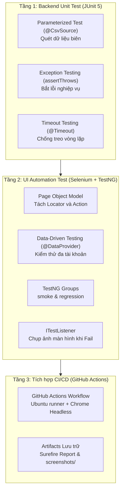

# KẾ HOẠCH KIỂM THỬ TỰ ĐỘNG (TEST PLAN)
## DỰ ÁN: WEBSITE BÁN MỸ PHẨM COSMETICSSTORE
* **Môn học:** SOF309 - Kiểm thử nâng cao cùng AI  
* **Sinh viên thực hiện:** Nguyễn Hoàng Trâm Anh  
* **Mã số sinh viên:** TS03179  
* **Lớp:** SD21304  
* **Giảng viên hướng dẫn:** ThS. Trần Quang Bình (binhtq7)  
* **Ngày lập kế hoạch:** 18/11/2026  
* **Phiên bản tài liệu:** 1.0  

---

## 1. GIỚI THIỆU & MỤC TIÊU KIỂM THỬ (INTRODUCTION & OBJECTIVES)

### 1.1. Giới thiệu tổng quan
Dự án **CosmeticsStore** là hệ thống web thương mại điện tử chuyên cung cấp các mặt hàng mỹ phẩm, chăm sóc sắc đẹp trực tuyến. Kế hoạch kiểm thử này được thiết lập nhằm xây dựng hệ thống kiểm thử tự động toàn diện từ tầng backend (Unit Test) đến tầng giao diện người dùng (Automation UI Test), tích hợp cùng đường ống CI/CD.

### 1.2. Mục tiêu kiểm thử
* **Đảm bảo tính chính xác của nghiệp vụ:** Kiểm tra toàn bộ logic xử lý dữ liệu của Controller và Service bằng JUnit 5.
* **Tự động hóa kiểm thử giao diện (UI Automation):** Sử dụng Selenium WebDriver và mô hình Page Object Model (POM) để tự động hóa các luồng thao tác người dùng chính (Đăng nhập, Đăng ký, CRUD Sản phẩm).
* **Tăng độ bao phủ kiểm thử (Test Coverage):** Áp dụng kỹ thuật kiểm thử tham số hóa (`@ParameterizedTest`), Data-Driven Testing (`@DataProvider`) để kiểm tra các tập dữ liệu biên.
* **Tích hợp liên tục (CI/CD Pipeline):** Tự động thực thi toàn bộ kịch bản kiểm thử trên máy chủ ảo GitHub Actions mỗi khi có mã nguồn mới được đẩy lên repository.
* **Ứng dụng Trí tuệ nhân tạo (AI-Driven Testing):** Sử dụng các công cụ AI (GenAI, RAG) để sinh kịch bản test, tối ưu mã nguồn và phân tích log lỗi tự động.

---

## 2. PHẠM VI KIỂM THỬ (TEST SCOPE)

### 2.1. Trong phạm vi kiểm thử (In-Scope)
* **Kiểm thử Đơn vị Backend (Unit Test - Y3):**
  * `LoginController`: Kiểm tra logic xác thực tài khoản Khách hàng, tài khoản Admin, xử lý đăng nhập sai, tham số hóa validation.
  * `RegisterController`: Kiểm tra logic đăng ký, xử lý ngoại lệ khi trùng lặp Email.
  * `ProductServlet`: Kiểm tra logic tính toán giá, số lượng tồn kho, kiểm tra ngoại lệ khi dữ liệu biên âm hoặc rỗng.
* **Kiểm thử Giao diện Tự động (Selenium UI Test - Y4):**
  * Chức năng Đăng nhập (`/login`): Luồng thành công, luồng thất bại do sai thông tin hoặc bỏ trống.
  * Chức năng Đăng ký (`/register`): Đăng ký tài khoản thành công, báo lỗi trùng email.
  * Chức năng Quản lý Sản phẩm (`/admin/product`): Thêm mới sản phẩm hợp lệ, kiểm tra thông báo lỗi validation trên form, cập nhật và xóa sản phẩm.
* **Tự động hóa CI/CD (Y5):**
  * Thiết lập workflow GitHub Actions trên môi trường Ubuntu (`ubuntu-latest`).
  * Thực thi kiểm thử ở chế độ Chrome Headless (`--headless=new`).
  * Tự động thu thập báo cáo kiểm thử Surefire Report và ảnh chụp màn hình khi lỗi (`screenshots/`).

### 2.2. Ngoài phạm vi kiểm thử (Out-of-Scope)
* Kiểm thử hiệu năng chịu tải quy mô lớn (Performance / Stress Testing > 10.000 users đồng thời).
* Kiểm thử an toàn thông tin chuyên sâu (Penetration Testing, XSS/CSRF nâng cao).
* Kiểm thử tương thích trên các trình duyệt cũ không còn hỗ trợ (Internet Explorer, Safari trên macOS cũ).

---

## 3. CHIẾN LƯỢC KIỂM THỬ (TEST STRATEGY & APPROACH)

### 3.1. Chiến lược Unit Test (JUnit 5)
* Áp dụng `@ParameterizedTest` kết hợp `@CsvSource` để truyền nhiều bộ dữ liệu (rỗng, ký tự đặc biệt, giá trị biên, giá trị hợp lệ) vào cùng một hàm test.
* Áp dụng `assertThrows()` để xác minh Controller ném đúng ngoại lệ khi nhận dữ liệu vi phạm nghiệp vụ (giá âm, số lượng âm, email trùng).
* Thiết lập giới hạn thời gian thực thi `@Timeout(value = 2, unit = TimeUnit.SECONDS)` nhằm đảm bảo hiệu năng hàm.

### 3.2. Chiến lược UI Automation (Selenium POM & TestNG)
* **Kiến trúc Page Object Model (POM):**
  * Thư mục `pages/`: Định nghĩa các Web Element Locator (`By.id`, `By.name`, `By.xpath`) và các phương thức tương tác người dùng.
  * Thư mục `tests/`: Chứa các kịch bản kiểm thử điều phối luồng và thực hiện assert kết quả.
* **Cơ chế chờ đợi đồng bộ (Synchronization):** Bắt buộc sử dụng `WebDriverWait` kết hợp `ExpectedConditions` (chờ element hiển thị, clickable), nghiêm cấm sử dụng `Thread.sleep()`.
* **Phân nhóm kiểm thử (Grouping):**
  * Group `"smoke"`: Các kịch bản kiểm thử quan trọng sống còn (Đăng nhập hợp lệ, Thêm sản phẩm hợp lệ).
  * Group `"regression"`: Các kịch bản kiểm tra validation chi tiết, giá trị biên và các ca lỗi.
* **Tự động chụp ảnh màn hình lỗi:** Cấu hình `ITestListener` trong class `TestListener.java` để tự động kích hoạt `TakesScreenshot` và lưu ảnh vào thư mục `screenshots/` mỗi khi một kịch bản bị Fail.

### 3.3. Chiến lược CI/CD
* Cấu hình file workflow `.github/workflows/test.yml`.
* Kích hoạt tự động khi có sự kiện `push` hoặc tạo `pull_request` vào nhánh `main`.
* Môi trường thực thi: Ubuntu Latest, JDK 17, Chrome Headless.
* Kết quả kiểm thử và ảnh chụp lỗi được đóng gói và upload lên tab **Artifacts**.

---

## 4. MÔI TRƯỜNG KIỂM THỬ (TEST ENVIRONMENT)

| Thành phần | Môi trường Local (Phát triển) | Môi trường CI/CD (GitHub Actions) |
| :--- | :--- | :--- |
| **Hệ điều hành** | Windows 11 64-bit | Ubuntu 22.04 LTS (GitHub Hosted Runner) |
| **JDK Version** | Eclipse Temurin JDK 17 / Oracle JDK 21 | Eclipse Temurin JDK 17 |
| **Web Server** | Apache Tomcat 10.1.x (Port 8080) | Embedded / Localhost Runner |
| **Cơ sở dữ liệu** | Microsoft SQL Server 2019/2022 | H2 Database / Mock SQL Server |
| **Trình duyệt** | Google Chrome (Giao diện đồ họa UI) | Google Chrome Headless (`--headless=new`) |
| **Build Tool** | Apache Maven 3.9+ | Apache Maven tích hợp sẵn trong Runner |

---

## 5. TIÊU CHÍ CHẤP THUẬN & HOÀN THÀNH (CRITERIA FOR PASS/FAIL)
* **Tiêu chí Hoàn thành Kiểm thử Đơn vị (JUnit 5):**
  * Lệnh `mvn test` thực thi 100% các ca kiểm thử đạt kết quả **Pass**.
  * Không có bất kỳ lỗi không bắt được (Uncaught Exception) hay lỗi Crash hệ thống.
* **Tiêu chí Hoàn thành Kiểm thử Giao diện (Selenium):**
  * Toàn bộ kịch bản trong nhóm `"smoke"` chạy thành công 100%.
  * Trường hợp test fail (nếu có ở nhóm regression để kiểm chứng) phải có ảnh chụp màn hình ghi nhận trong thư mục `screenshots/`.
* **Tiêu chí CI/CD:**
  * Workflow trên GitHub Actions chạy thành công và hiển thị dấu tích **Xanh (Pass)**.
  * Tải và giải nén được bộ báo cáo kết quả kiểm thử trong tab Artifacts.
* **Tiêu chí Hồ sơ AI (Y6 - Điểm A):**
  * Đầy đủ 6 file nhật ký minh chứng tương tác AI trong thư mục `docs/ai-logs/`.
